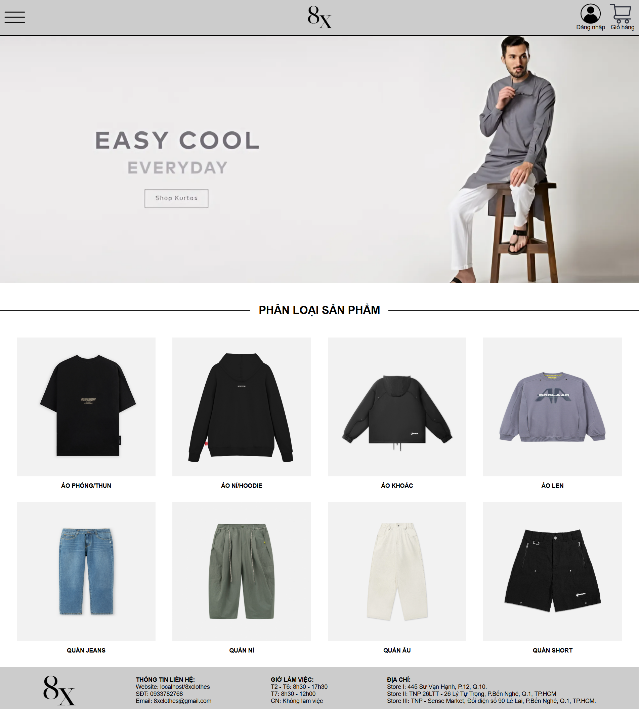
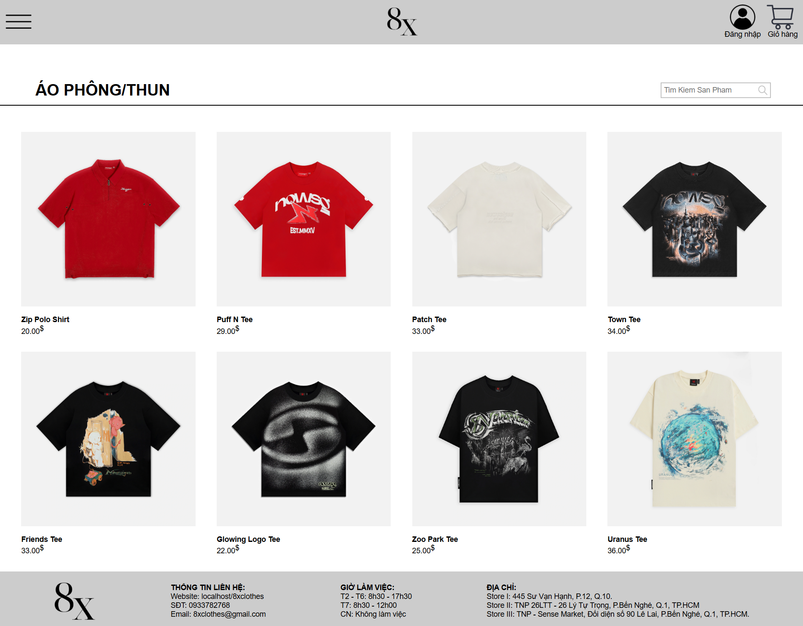
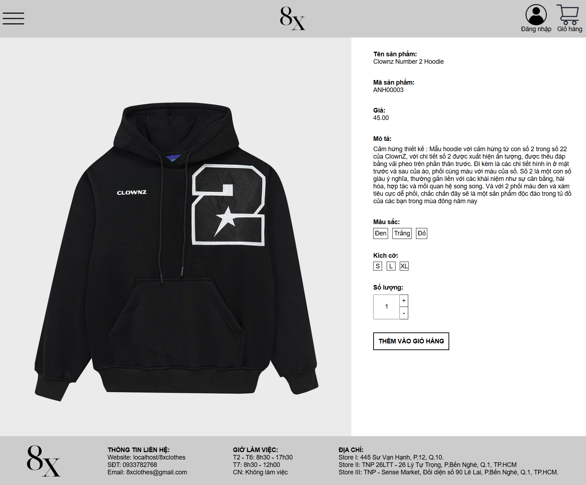
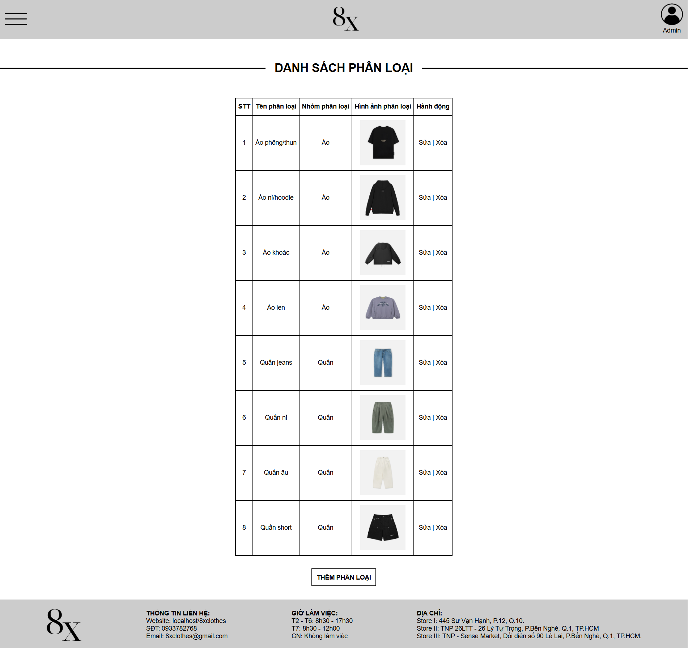
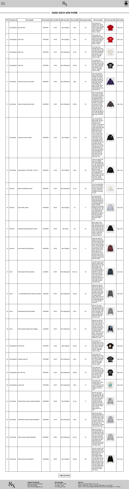

# 8XCLOTHES

A project to develop an online clothing store, including features such as login, category management, product management, order management, and report management. Some features have been completed, while others are still incomplete.

Below are some previews of the website in operation:

**1. Homepage**

Displays promotional banners and a list of product categories, helping customers easily search for and select products.

**2. Product Listing**

Displays products belonging to the selected category, including the image, name, and selling price of each product.

**3. Product Details**

Displays detailed product information such as images, name, product ID, selling price, description, colors, and sizes, allowing customers to select the quantity and add products to their shopping cart.

**4. Category Management (Admin)**

The administration interface allows admins to view the list of product categories, add new categories, edit, and delete categories.

**5. Product Management (Admin)**

The administration interface allows admins to view the list of products, add new products, edit product information, update prices, and delete products.

For more details, please visit the website through the following links:

- **For customers:** https://8xclothes.infinityfreeapp.com

- **For admins:** https://8xclothes.infinityfreeapp.com/admin.php

If the links are inaccessible, please contact me via email: lenhathoang11@outlook.com.